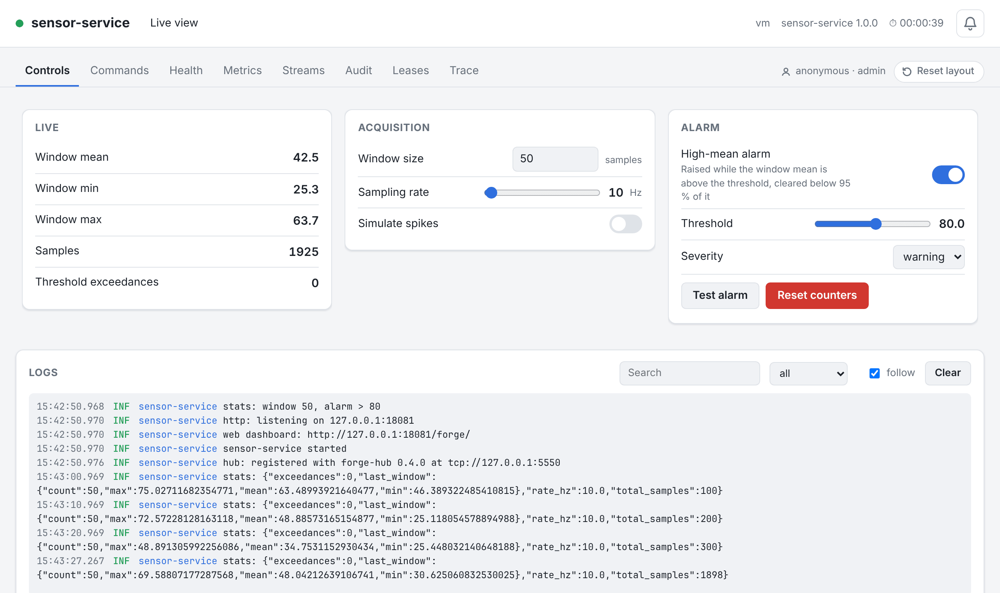
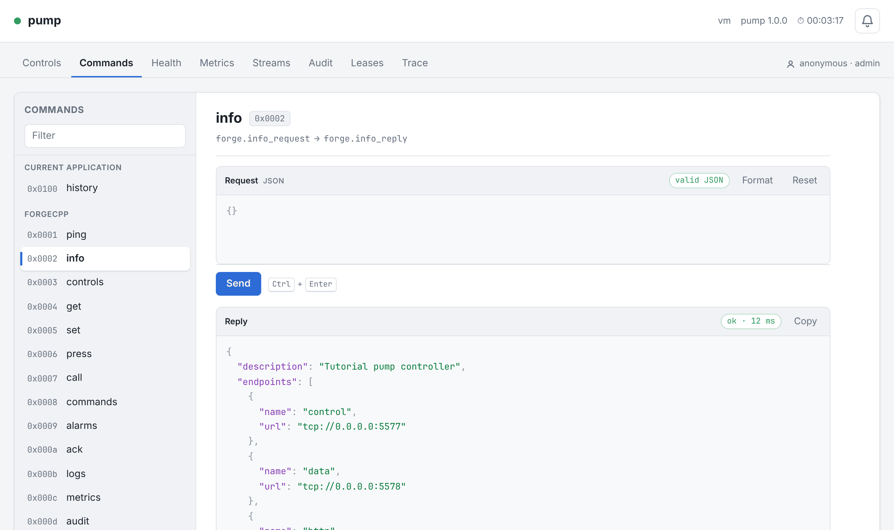
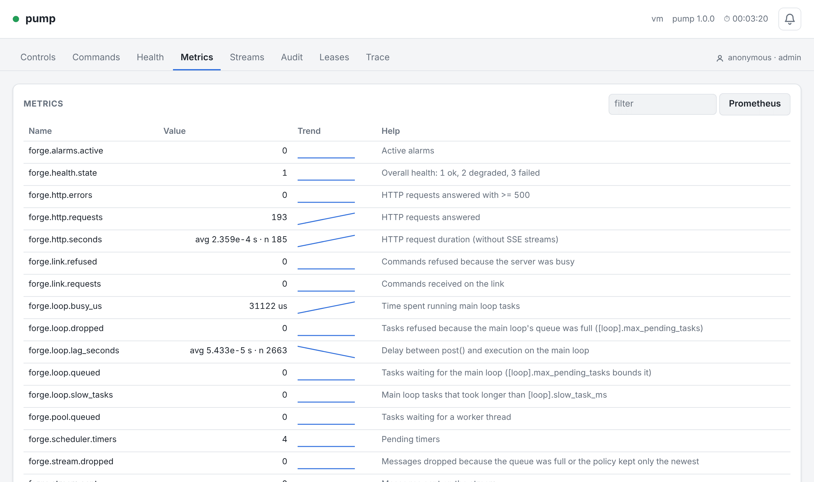
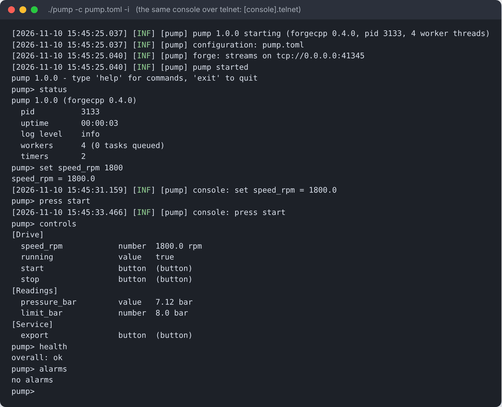
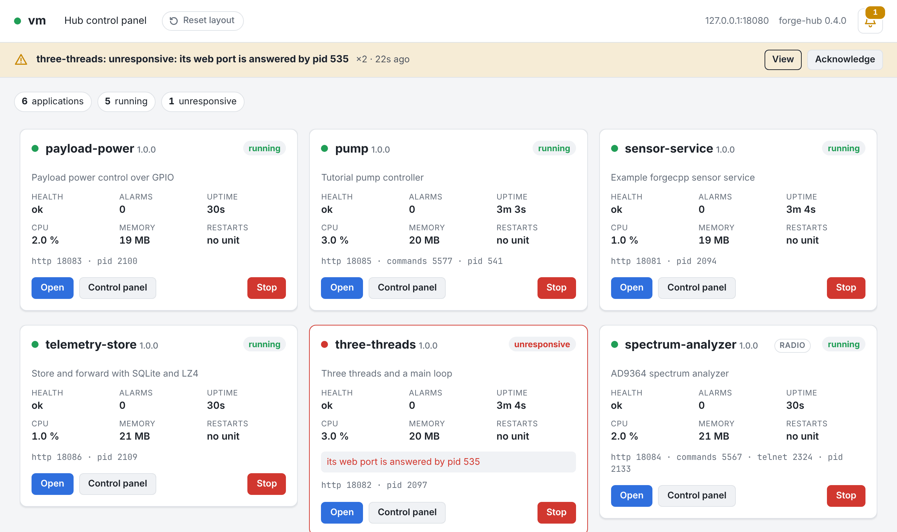
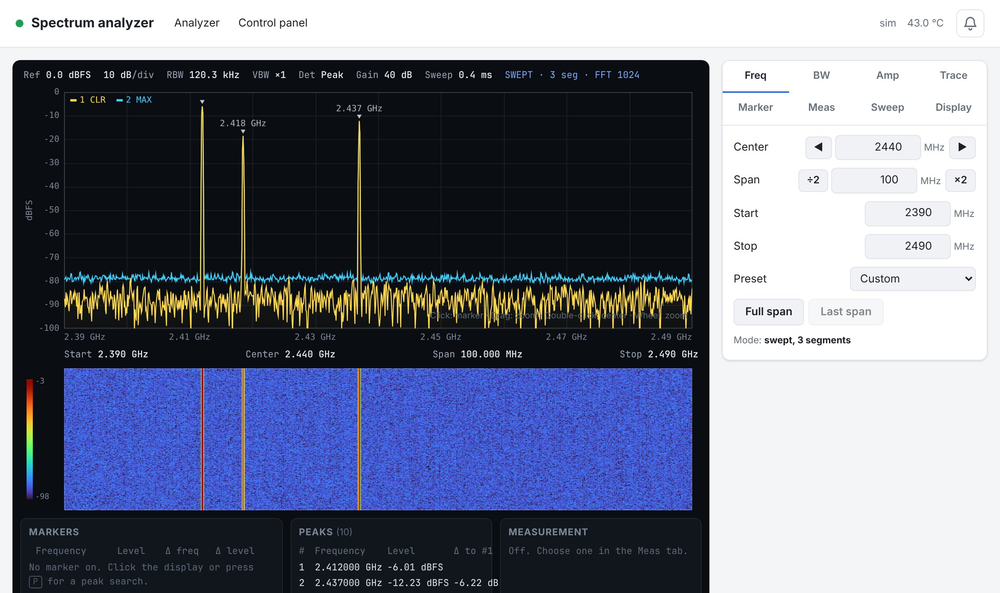
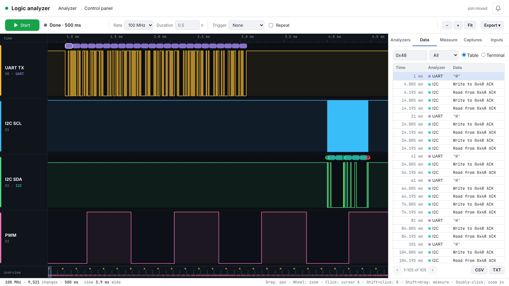

<h1 align="center">forgecpp</h1>

<p align="center">
  <b>A batteries-included C++20 framework for embedded Linux daemons.</b><br>
  Write the application logic once; get a web control panel, a command link, a remote console,
  metrics, health checks and a systemd unit with it.
</p>

<p align="center">
  <a href="https://github.com/dogukanarat/forgecpp/actions/workflows/ci.yml"></a>
  <a href="LICENSE"></a>
  
  
  
  
</p>

<p align="center">
  
</p>

---

## Contents

- [Why forgecpp](#why-forgecpp)
- [Features](#features)
- [Screenshots](#screenshots)
- [Quick start](#quick-start)
- [Using it in your project](#using-it-in-your-project)
- [Examples](#examples)
- [Documentation](#documentation)
- [Strengths and limitations](#strengths-and-limitations)
- [Roadmap](#roadmap)
- [Contributing](#contributing)
- [License](#license)

## Why forgecpp

A device on a satellite, a radio, a test bench or a lab instrument usually runs
several Linux programs: one per piece of hardware or per job. Each of them
needs the same things besides its own logic: configuration, logging, a way to
change settings and send commands while it runs, a way to see what it is doing,
a clean shutdown, a restart when it hangs, and a way to be tested without the
hardware. Written again for every program, these parts differ from one program
to the next, and an engineer has to learn each one.

forgecpp gives every program the same foundation. You subclass
`forge::Application`, declare your controls and commands in C++, and the
framework publishes them everywhere at once:

```cpp
#include <forge/forge.hpp>
using namespace std::chrono_literals;

class Pump : public forge::Application {
public:
    Pump() : Application({"pump", "1.0.0", "Pump control service"}) {}

protected:
    void setup_controls(forge::Controls& ui) override {
        auto& g = ui.group("Pump");
        g.toggle("running", "Running", running_);
        g.slider("speed", "Speed", speed_, 0, 3000, 10).unit("rpm");
        g.value("pressure", "Pressure", pressure_).unit("bar").precision(2);
        g.button("flush", "Flush", [this] { flush(); }).confirm("Start flushing?");
    }
    void on_start() override {
        every(500ms, [this] { pressure_ = read_pressure(); });
    }

private:
    double read_pressure() { return running_ ? speed_ / 1000.0 : 0.0; }
    void flush() { logger()->info("flushing"); }
    bool running_ = false;
    int speed_ = 1200;
    double pressure_ = 0;
};

FORGE_MAIN(Pump)
```

That program now has all of these, with no extra code (the endpoints are
usually set in its configuration file; here on the command line):

```sh
./pump --http 8080                              # web control panel: http://device:8080/forge/
./pump --http 8080 -i                           # + an interactive console: set speed 1500, press flush
./pump -D forge.control=tcp://*:5557 -D console.telnet=0.0.0.0:2323
forgectl -e tcp://device:5557 set speed 1500    # the same controls over ZeroMQ, from another machine
telnet device 2323                              # the console, remotely
curl device:8080/metrics                        # Prometheus metrics; /health for the watchdog and probes
kill -HUP $(pidof pump)                         # reload the configuration
```

Every forgecpp program on a device is operated, observed and connected the
same way, so a team learns one set of tools.

## Features

**Application skeleton**
- `forge::Application` with a main loop, timers, signal handling, clean shutdown and
  configuration reload; typed configuration (TOML) with a schema, defaults and
  validation; command line (CLI11) and `-D key=value` overrides.
- Threads done safely: named workers with real-time priorities, a thread pool,
  lock-free channels, `post()` / `invoke()` onto the main loop, and checks that
  refuse the most common mistakes ([threading](docs/threading.md)).
- Asynchronous logging (Quill) to the terminal, files, syslog, the web panel and telnet.

**Control and commands**
- One declaration of a control or command serves the **web panel**, your own web
  pages (`data-forge-*` attributes), the **command link** (`forgectl`), the local
  console and a **remote console over telnet**.
- Roles, leases (who may change what) and an audit trail of every change.
- **One message standard, binary and JSON**: commands are numbered request/reply pairs in
  `.proto` files with fixed bounds (nanopb: no allocation). Links carry them as
  c2 frames, byte for byte like [zephyrus](https://github.com/embedded-aviation/zephyrus)
  on microcontrollers: over **ZeroMQ**, a **serial line** or a **CAN bus** (ISO-TP).
  The web sends the same commands as JSON; one handler answers both.
- Streams with a header (source, sequence, time, trace context): gaps are detected
  and data can be followed from one program to the next.

**Observability and operations**
- Metrics (Prometheus `/metrics`), a flight recorder of trace spans (Perfetto),
  crash reports, structured JSON logs, alarms with acknowledgement.
- Health checks tied to the systemd watchdog; `forge_add_app()` generates the
  systemd unit with its restart policy and hardening.
- **forge-hub**: a dashboard of every forgecpp program on the device (health, alarms,
  CPU, memory, restarts), with a proxy to each program's page.

**Hardware and storage**
- GPIO (the kernel's character device, with a simulated chip for PCs and tests) and
  CAN (raw frames, commands over ISO-TP) without extra libraries.
- Optional components: SQLite with a store-and-forward backlog, LZ4, and SQLite
  tables as C++ structs (sqlite_orm).

**Built for embedded Linux**
- Shared libraries, built from git submodules by one `install.sh`, or by a
  **Yocto layer** that needs only oe-core.
- Cross builds (a Zynq-7000 armhf toolchain file and CI job).
- A project scaffolder (`forgecpp-new`) and test helpers that run a whole
  application in a test with a **manual clock** (no sleeps, no flaky timing).

## Screenshots

<table>
<tr>
<td width="50%"></td>
<td width="50%"></td>
</tr>
<tr>
<td><b>Commands.</b> Every command of the program with a JSON form. The same
commands answer binary c2 frames on ZeroMQ, a serial line or a CAN bus.</td>
<td><b>Metrics.</b> The framework's and the application's, with a trend; also
<code>/metrics</code> for Prometheus. Health, streams, audit, leases and the
flight recorder have pages too.</td>
</tr>
<tr>
<td></td>
<td></td>
</tr>
<tr>
<td><b>Console.</b> The same controls and commands without a browser: <code>-i</code>
on the terminal, or telnet on a remote device.</td>
<td><b>forge-hub.</b> Every forgecpp program on the device: health, alarms,
CPU and memory, systemd restarts, and the way into each one's panel.</td>
</tr>
</table>

Applications add their own pages next to the panel. Two of the examples:

**Spectrum analyzer** (`examples/spectrum-analyzer`) on an AD936x transceiver, here on its simulator:



**Logic analyzer** (`examples/logic-analyzer`) for a Zynq-7000 with an FPGA capture
core: UART, I2C and SPI decoded, a searchable data table, cursors and measurements:



## Quick start

**Requirements:** Linux; CMake ≥ 3.16; GCC ≥ 13 or Clang ≥ 17 (with libstdc++ 13);
git; Python 3 with `protobuf` (`apt install python3-protobuf`; the message
generator runs at build time). Optional: ninja, OpenSSL (HTTPS), zlib,
libxml2 (for libiio; or `--without-iio`).

```sh
git clone --recursive https://github.com/dogukanarat/forgecpp.git
cd forgecpp
./install.sh --prefix ~/.local          # builds the bundled libraries and forgecpp
```

Or in one line (clones into a temporary directory, installs, cleans up):

```sh
curl -fsSL https://raw.githubusercontent.com/dogukanarat/forgecpp/master/get.sh | bash -s -- --prefix ~/.local
```

Make a new application and run it:

```sh
forgecpp-new my-daemon && cd my-daemon
cmake -B build -DCMAKE_PREFIX_PATH=~/.local && cmake --build build -j
ctest --test-dir build                                  # its tests
./build/my-daemon -c config/my-daemon.toml -i           # http://localhost:8080/forge/ + console
sudo cmake --install build                              # binary, config, systemd unit
```

The generated project has an `Application` subclass with controls and a
command, its own messages, its own web page (embedded in the binary), a
configuration file, tests and a Python client. `forgecpp-new --minimal` makes
the smallest shape (about 100 lines). Every `install.sh` option, cross builds
and Yocto: [docs/installation.md](docs/installation.md).

To try the examples instead:

```sh
./install.sh --prefix ~/.local --examples
cd build/forgecpp/examples
./sensor-service -c sensor-service.toml -i            # http://localhost:8080/forge/
./logic-analyzer/logic-analyzer -c logic-analyzer/logic-analyzer.toml   # http://localhost:8084/
```

## Using it in your project

```cmake
find_package(forgecpp 0.4 REQUIRED)
forge_add_app(mydaemon
    SOURCES src/main.cpp
    CONFIG  config/mydaemon.toml        # installed as <sysconfdir>/mydaemon/mydaemon.toml
    WEB     web                         # every file under web/ is embedded in the binary
    RESTART on-failure WATCHDOG 30)     # the generated systemd unit
forge_add_test(mydaemon_tests SOURCES tests/test_main.cpp)

# optional components (docs/storage.md)
find_package(forgecpp 0.4 REQUIRED COMPONENTS sqlite lz4)
target_link_libraries(recorder PRIVATE forgecpp::sqlite forgecpp::lz4)
```

Without CMake: `pkg-config --cflags --libs forgecpp`. On a Yocto build, add
the layer in [`yocto/`](yocto/README.md) and your application's recipe on top
of it.

A test runs the whole application, with time under the test's control:

```cpp
#include <forge/testing.hpp>

TEST_CASE("the pump builds pressure") {
    forge::testing::AppRunner<Pump> r({}, {.manual_time = true});
    r->invoke([&] { r->dashboard()->set("running", true); });
    r.advance(1s);                       // every timer due in 1 s has run, no sleeping
    CHECK(r->invoke([&] { return r->dashboard()->get("pressure").get<double>(); }) == doctest::Approx(1.2));
}
```

## Examples

| Example | What it shows |
|---|---|
| [`hello`](examples/hello/main.cpp) | The smallest daemon (lambda style) with a console command |
| [`pump`](examples/pump) | The application of the [tutorials](docs/tutorials/README.md): controls, configuration, timers, alarms, a command, a stream, tests |
| `sensor-service` | Every building block: channel, thread pool, events, control panel, own page, an alarm with hysteresis |
| `pipeline`, `three-threads` | Multi-threaded processing: producer threads, lock-free channels, a thread pool, back-pressure, named worker threads with priorities, clean shutdown |
| `thermostat` | A web-first application: its own multi-page site, REST API with validation, live data, persisted settings |
| `payload-power` | **GPIO**: a payload's power switch and power-good line as a state machine (retries, alarms, brown-out); runs on the simulated chip |
| `can-node` | **CAN**: heartbeat and sensor frames, commands over ISO-TP; a Python node on the other side (vcan on a PC) |
| `telemetry-store` | **SQLite + LZ4**: store and forward between ground passes, survives restarts, a pass log in SQL |
| `fault-log` | **SQLite without SQL** (`forge::orm`): a fault log as two C++ structs |
| [`radio-controller`](examples/radio-controller/README.md) | **AD936x radio daemon** (libiio + ZeroMQ): tuning, gain, IQ streaming with zero copy, live spectrum page, reconnect, a hardware simulator, Yocto recipe |
| [`spectrum-analyzer`](examples/spectrum-analyzer/README.md) | **Spectrum analyzer** on an AD936x: realtime and swept spans to 6 GHz, traces, markers, peak search, waterfall, channel power, limit line |
| [`qam-modem`](examples/qam-modem/README.md) | **16QAM packet modem**: UDP in, radio out and back, 2.9 Mbit/s net in 1 MHz; synchronization, timing and phase recovery, constellation page |
| [`channel-emulator`](examples/channel-emulator/README.md) | **Radio channel emulator**: noise, frequency offset, multipath, fading, IQ imbalance, each a control |
| [`logic-analyzer`](examples/logic-analyzer/README.md) | **Four-channel logic analyzer** on a Zynq-7000 (Arty Z7): the FPGA sends changes instead of samples; triggers, UART/I2C/SPI decoders, data table, measurements, saved captures, VCD export. FPGA design and Verilog in [`fpga/`](examples/logic-analyzer/fpga/README.md) |

Every example builds with `./install.sh --examples` and runs on a PC, with a
simulator where it needs hardware; all but the smallest ones (hello,
sensor-service, pipeline, thermostat) have tests. The radio examples and the logic
analyzer are also standalone CMake projects with Yocto recipes.

## Documentation

| | |
|---|---|
| [Tutorials](docs/tutorials/README.md) | A pump controller, step by step: controls, configuration, timers, alarms, threads, testing, streams, deployment |
| [The application and its services](docs/application.md) | `forge::Application`, the command line, configuration keys, logging, channels, the thread pool, HTTP, alarms, the console, testing |
| [Threads](docs/threading.md) | Which thread may do what, and how to hand work between them |
| [The web panel](docs/web.md) | The control panel at `/forge/`, `data-forge-*` attributes for your own pages |
| [Commands and streams](docs/messaging.md) | The message standard; [adding a command](docs/commands.md); [the wire format](docs/protocol.md) |
| [GPIO and CAN](docs/hardware-io.md) | Lines, edges, the simulated chip; CAN frames, commands over ISO-TP, vcan |
| [Storage and compression](docs/storage.md) | SQLite, store and forward, LZ4, tables as structs (sqlite_orm) |
| [Running it](docs/operations.md) | Access control, leases, the audit trail, observability, forge-hub |
| [Field notes](docs/field-notes.md) | The first weeks on a device: ports, debugging, persisted controls, time without an RTC |
| [Installation](docs/installation.md) | Every `install.sh` option, cross builds, Yocto, build times |
| [Yocto layer](yocto/README.md) | The `meta-forgecpp` layer, its recipes, kas builds |
| [Working on forgecpp](docs/development.md) | `tools/check.sh`, presets, fuzzing, releases, the repository layout |
| [API stability](docs/API.md) · [Coding standards](docs/CODING_STANDARDS.md) · [Roadmap](docs/ROADMAP.md) · [Changelog](CHANGELOG.md) | |

The API reference is built with Doxygen: `cmake --build build --target forgecpp_docs`.

## Strengths and limitations

**What forgecpp does well**

- **One way to operate every program.** The panel, the command link, the console,
  telnet, metrics, health and logs are the same in every application, and a new
  control appears in all of them from one line of C++.
- **Talks to microcontrollers natively.** The c2 frames are byte-compatible with
  zephyrus, checked in CI against its C code; the same command reaches a program
  on Linux or a microcontroller over ZeroMQ, a UART or CAN.
- **Allocation-free, bounded messages** with compatibility rules enforced in CI
  (`tools/proto-compat.py`, `tools/api-check.py`): released messages and
  configuration keys do not break within a minor version.
- **Testable without hardware.** Simulators for the hardware the examples use
  (GPIO chip, AD936x, the logic analyzer's FPGA), an `AppRunner` that runs a whole
  application in a test, and a manual clock for timer logic.
- **Checked broadly.** Unit and integration tests, fuzz targets, AddressSanitizer,
  UBSan and ThreadSanitizer jobs, browser tests of the panel, real systemd units in
  CI, an armhf cross build run under QEMU, and a nightly Yocto image with runtime tests.
- **Ready for embedded Linux.** Shared libraries, generated and hardened systemd
  units with watchdogs, a Yocto layer on oe-core only, a Zynq-7000 toolchain.
- **Real applications as examples**, not toys: a radio daemon, a spectrum analyzer,
  a QAM modem, a channel emulator and a logic analyzer.

**What is not there yet**

- **Security is not done.** There is no authentication unless `[auth]` is
  configured, HTTP has no TLS, telnet is plain text, and commands on a link carry
  no credentials. forgecpp is meant for the lab and trusted networks today; the
  [pre-production security work](docs/ROADMAP.md#3-security) is planned. Do not
  expose a forgecpp program to an untrusted network.
- **Pre-1.0.** A new minor version (0.5) may change the C++ API; every break is in
  the changelog. Messages and configuration keys change only compatibly.
- **Hardware paths not yet run on hardware.** GPIO, CAN, the AD936x radio on a
  real board and the logic analyzer's FPGA core are written to the kernel and
  register interfaces and tested against simulators and socket pairs; bring-up on
  the boards is next. The Yocto recipes are parsed and resolved on scarthgap but
  have not been through a full bitbake build.
- **Linux only**, GCC 13+ or Clang 17+; no Windows or macOS.
- **Dependencies are built from source** by `install.sh` (or Yocto): no vcpkg or
  Conan packages yet.
- **Not included yet:** WebSockets (the panel uses Server-Sent Events), MQTT,
  Modbus and OPC UA connectors, Python bindings, an `async`/`await` API
  (sequences are explicit state machines, see [threading](docs/threading.md#sequences-a-state-machine)).

## Roadmap

The near-term plan, in [docs/ROADMAP.md](docs/ROADMAP.md):

1. **Hardware bring-up** on a Zynq-7000 board: GPIO and CAN on real lines and
   buses, the radio examples on an FMCOMMS5, the logic analyzer's FPGA core
   (register block, DDR writer, block design).
2. **Security** before production use: secure defaults, TLS, ssh instead of
   telnet, roles for commands on links.
3. **1.0**: a stable C++ API with symbol visibility and ABI checks.
4. Later: connectors (MQTT, Modbus, OPC UA), WebSockets, Python bindings, package
   manager support.

## Contributing

Contributions are welcome: bug reports, documentation, examples and code.
Read [CONTRIBUTING.md](CONTRIBUTING.md) for how to build, test and send a
change, and the [Code of Conduct](CODE_OF_CONDUCT.md). Report security issues
privately as described in [SECURITY.md](SECURITY.md).

## License

forgecpp is released under the [MIT License](LICENSE).

The bundled libraries keep their own licenses. The compiled ones are shared
libraries; header-only ones and those marked "compiled in" become part of the
programs:

| Library | Version | License | Used for |
|---|---|---|---|
| [Quill](https://github.com/odygrd/quill) | v13.1.0 | MIT | logging |
| [CLI11](https://github.com/CLIUtils/CLI11) | v2.7.2 | BSD-3-Clause | command line |
| [linenoise](https://github.com/antirez/linenoise) | a473823 | BSD-2-Clause (compiled in) | console line editing |
| [BS::thread_pool](https://github.com/bshoshany/thread-pool) | v5.1.0 | MIT (compiled in) | thread pool |
| [moodycamel::ConcurrentQueue](https://github.com/cameron314/concurrentqueue) | v1.0.5 | BSD-2-Clause / BSL-1.0 | lock-free channels |
| [nlohmann/json](https://github.com/nlohmann/json) | v3.12.0 | MIT | JSON |
| [toml++](https://github.com/marzer/tomlplusplus) | v3.4.0 | MIT | configuration |
| [cpp-httplib](https://github.com/yhirose/cpp-httplib) | v0.65.0 | MIT | HTTP server and client |
| [libzmq](https://github.com/zeromq/libzmq) + [cppzmq](https://github.com/zeromq/cppzmq) | v4.3.5 / v4.11.0 | MPL-2.0 / MIT | command link, streams |
| [nanopb](https://github.com/nanopb/nanopb) | 0.4.9.2 | Zlib (compiled in) | messages |
| [protobuf](https://github.com/protocolbuffers/protobuf) | v21.12 | BSD-3-Clause | `protoc` on the build machine only |
| [doctest](https://github.com/doctest/doctest) | v2.5.3 | MIT | tests |
| [SQLite](https://github.com/sqlite/sqlite) | 3.54.1 | public domain | optional `forgecpp::sqlite` |
| [LZ4](https://github.com/lz4/lz4) | v1.10.0 | BSD-2-Clause (tool: GPL-2.0) | optional `forgecpp::lz4` |
| [sqlite_orm](https://github.com/fnc12/sqlite_orm) | v1.9.1 | **AGPL-3.0** or commercial MIT | optional `forgecpp::orm`, header-only |
| [libiio](https://github.com/analogdevicesinc/libiio) | v0.26 | LGPL-2.1-or-later | the AD936x examples |
| [GridStack.js](https://github.com/gridstack/gridstack.js) | | MIT (in `src/web/vendor`) | panel card layout |

sqlite_orm is only compiled into programs that include `forge/orm.hpp`; such a
program is under the AGPL unless its commercial license is bought
([details](docs/storage.md#license-of-sqlite_orm)). Leave it out with
`./install.sh --without-sqlite-orm`. Linking libzmq and libiio dynamically (the
default) keeps the MPL and LGPL obligations simple.
