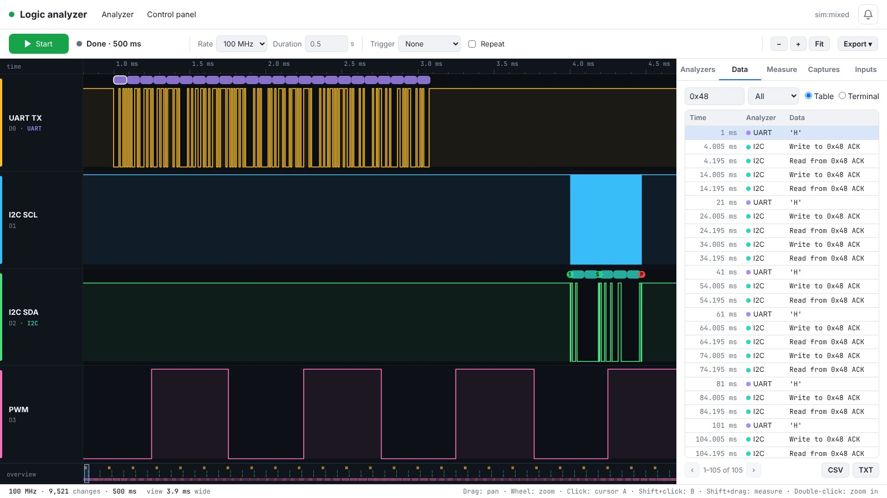
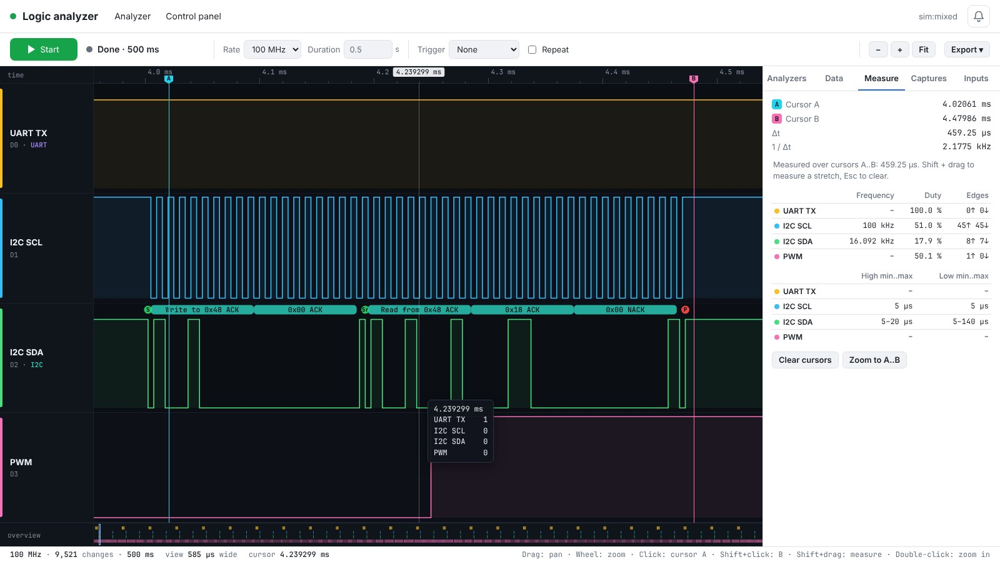

# logic-analyzer

A four-channel logic analyzer that runs on the board it measures with: a
Zynq-7000 (Arty Z7) with a shield of input comparators, and a page in the
browser. The FPGA sends **changes, not samples** (one 32-bit word per change,
with its time), so a capture is as long as the signals are quiet: minutes of
a UART at 10 ns resolution in 16 MB.



```
 shield (4 inputs) ─► FPGA capture core ─► DDR ring buffer ─► logic-analyzer ─► browser
 comparators,         change words,          (UIO)             capture, trigger,   waveforms,
 threshold from PWM   heartbeats, gaps                         decoders, files      decoders, exports
```

The FPGA design (word format, registers, device tree, shield) is in
[fpga/README.md](fpga/README.md); its input stage and encoder are written and
simulated. Without an FPGA the program runs on its **simulator**, which sends
the same words with real traffic on the four inputs.

## Running

```sh
./logic-analyzer -c logic-analyzer.toml                     # simulator: UART, I2C, PWM
./logic-analyzer -c logic-analyzer.toml --scenario spi      # a SPI flash (CS, SCK, MOSI, MISO)
./logic-analyzer -c logic-analyzer.toml --scenario uart     # command and answer at 9600 baud
./logic-analyzer -c logic-analyzer.toml --source uio        # the FPGA core (fpga/README.md)
```

Open `http://<host>:8084/`, press **Start** (or Space).

## The page

| | |
|---|---|
| **Capture** | Start / Stop; sample rate 100 kHz … 100 MHz; duration (0 = until Stop); repeat (arm again after each capture, like a scope's normal mode). The state shows *waiting for trigger*, *recording 0.42 s* with progress, *done*. The waveforms grow while recording |
| **Trigger** | rising, falling or any edge on a channel, or a pattern (`0`/`1`/`X` per channel: the first change into it); pre-trigger time kept before it (the trigger is armed once that much is recorded). 0 on the ruler is the trigger |
| **Waveforms** | wheel: zoom around the mouse; drag: pan; double-click: zoom in; F: fit; ←/→, +/−, Home/End. Where a pixel holds many changes it shows a block, never a wrong single edge. Overview strip at the bottom: the whole capture, click or drag to move there. A hatched "data lost" stretch where the FPGA dropped words |
| **Cursors** | click: cursor A, shift-click: B (or A/B keys at the mouse), drag their flags on the ruler; Δt and 1/Δt |
| **Measure** | per channel over the selection (shift-drag), the cursors or the visible part: frequency, duty, rising/falling count, high and low pulse widths (min‥max) |
| **Analyzers** | UART (bit rate, 5–9 bits, parity, stop bits, inverted, MSB first), I2C (7-bit address, R/W, ACK/NACK, repeated start), SPI (CS optional, CPOL/CPHA, 4–32 bits, bit order, CS polarity). Several of each; shown as hex, decimal, ASCII or binary. Frames are drawn as bubbles over their channel; errors in red (parity, framing, a byte cut by STOP, a word cut by CS) |
| **Data** | every decoded frame by time, all analyzers or one; search (`0x48`, `'A'`, `NACK`, `error`); click a row to jump there, click a bubble to find its row. **Terminal** view: what a UART said, as text |
| **Captures** | every finished capture is saved on the device (`[analyzer] keep_captures`, oldest removed): open, download (`.lacap`), delete; open a `.lacap` from the computer |
| **Inputs** | channel names (also: double-click a name), logic level (1.2 V … 5 V TTL) or threshold, glitch filter; the source's details and words/s, changes/s, words lost |
| **Export** | the capture as `.lacap` (opens here again), VCD (GTKWave, PulseView/sigrok), CSV of the changes; the protocol log as CSV or text; a PNG of the screen |



The capture settings are forgecpp controls: they are on `/forge/` too, kept
across restarts (`[state] file`), and `forgectl` sets them
(`forgectl -e tcp://board:5597 set trigger falling`, `press start`).

## Console

`telnet board 2327` (or `-i`):

```
capture [start|stop]      status
analyzers                 decode [analyzer id] [n]
```

```
logic-analyzer> decode a2 6
      0.484285 s  I2C          0x1A ACK
      0.484375 s  I2C          0xCC NACK
      0.484472 s  I2C          Stop
      0.494003 s  I2C          Start
      0.494005 s  I2C          Write to 0x50 NACK
      0.494103 s  I2C          Stop
logic-analyzer> status
state idle  recorded 0.500 s  0 words/s  0 changes/s  lost 0
capture 1  0.500000 s  9521 changes  at 100 MHz  no trigger
```

## Files and the HTTP API

| Path | |
|---|---|
| `GET /api/status` | state, capture summary, settings, source |
| `GET /api/view?from=&to=&px=` | the changes of each channel in [from, to] (ticks), thinned to `px` |
| `GET /api/frames?from=&to=&px=` | decoded frames there (dense stretches as blocks) |
| `GET /api/table?offset=&limit=&q=&analyzer=&at=` | the data table |
| `GET /api/measure?from=&to=` | measurements per channel |
| `GET /api/terminal?analyzer=` | UART text |
| `GET/POST/PUT/DELETE /api/analyzers[/id]` | the analyzers (`GET /api/meta` lists the types and their settings) |
| `GET /api/captures`, `POST /api/captures/load`, `POST /api/captures/live`, `POST /api/captures/import`, `GET/DELETE /api/captures/<file>` | saved captures |
| `GET /api/export/capture.{lacap,vcd,csv}`, `/api/export/decoded.{csv,txt}` | exports of the capture shown |

A `.lacap` file is a JSON header line and then the words of the FPGA's
format, 4 bytes a change.

## Inside

| File | |
|---|---|
| `src/wire.hpp` | the FPGA's words: encoder and decoder |
| `src/capture.*` | a capture (ticks and levels of the changes, 9 bytes each), views, measurements |
| `src/decoders.*` | UART, I2C, SPI on the changes (no samples: a capture of seconds decodes in milliseconds) |
| `src/engine.*` | the capture thread: reads the source, trigger, pre-trigger, edge limit, gaps |
| `src/sim.*`, `src/uio_source.*` | the simulator; the FPGA core through UIO |
| `src/files.*` | `.lacap`, VCD, CSV, the store of captures |
| `src/app.*` | the application: controls, HTTP API, console, alarms (`la.source`, `la.lost`) |
| `web/` | the page (canvas, no libraries) |
| `fpga/` | the FPGA design, RTL and testbench |

Tests (`logic_analyzer_tests`): the words, the capture, views and
measurements, each decoder on simulated and hand-made signals (parity and
framing errors, a break, repeated start, NACK, SPI at too low a sample rate),
the engine's triggers, pre-trigger, stop, edge limit and lost words, the
files, and the whole application over HTTP. `make -C fpga/sim` simulates the
RTL.

On a 2.3 GHz Xeon the program records 72 M words/s and decodes SPI at
180 M changes/s; on the board, measure it (the Inputs tab shows words/s).
